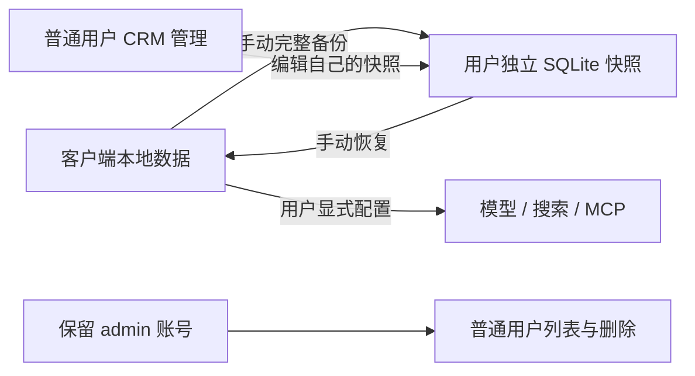

# 本地优先客户端与自托管快照后台设计

日期：2026-11-09。本文记录本轮本地化、手动同步、后台 CRM 和 Docker 部署的设计决策及实际边界。

## 1. 目标与架构

- 客户端和后台是独立应用，客户端本地数据为日常使用的权威来源。
- 后台仅作为按用户隔离的快照存档和管理工具，不参与 AI 推理，不主动读取客户端。
- 用户手动上传备份或下载恢复；不自动同步、合并、拉取目录或推送管理修改。
- 用户自己配置的模型、搜索、MCP 等显式网络能力与应用后台分离。
- 移除/停用官方商业提供商、遥测和自动升级入口及对应运行时调用；兼容历史数据所需的字段/枚举不等于恢复这些能力。



应用后台地址默认空值，无官方或回环自动回退。保存地址与打开设置页不发起请求；只有明确执行同步才登录并传输。后台地址和推理服务地址不是同一配置。

## 2. 本地助手与体验

### 初始化和语言

客户端第一次初始化时使用打包的助手素材和头像，不需要运行时访问后台。初始化标记持久化；已有助手列表（包括空数组）不被种子覆盖，删除后也不自动重新填充。

- 初始语言来自桌面系统或浏览器语言。
- 中文环境选择中文种子，其他环境选择英文种子。
- 当前素材为 36 位中文和 41 位英文助手；繁体中文环境也使用现有简体中文助手素材。
- 既有混合语言数据不自动裁剪或迁移。
- 种子素材顺序保持不变；头像先存入本地资源存储，再发布助手列表。

素材位于忽略提交的下载快照目录，客户端构建仍依赖这些离线输入。它们不属于后端 Docker 镜像；源码提交本身不保证包含这些第三方素材，发布前需核对来源和再分发权限。

### 分类、排序和分页

分类不是独立实体表，而是助手的可选 `category` 字段。从完整助手列表读取、去空格、过滤空值、去重并排序；未分类单独显示。分类汇总不受搜索、置顶筛选或分页影响。

- 置顶助手优先，组内保持原数组顺序，不按 ID 或时间二次排序。
- 客户端新增本来就是置前；后台新增调整为 `insert(0, value)`，编辑保持原位置。
- 新增非置顶助手位于非置顶组首位，仍在置顶助手之后。
- 页面默认筛选置顶；分类、搜索、全部、置顶均按本地每次 12 条加载更多。
- 空结果显示居中内置小猫插画和提示，无外部图片请求。

## 3. 快照格式与同步协议

传输的是自包含 SQLite 数据库，不是客户端的实时业务数据库，也不是关系化重建的全应用数据库。

| 项目 | 设计 |
| --- | --- |
| SQLite 版本标识 | `PRAGMA user_version=1` |
| 归档表 | `archive_entries(path TEXT PRIMARY KEY, data BLOB NOT NULL)` |
| 元信息表 | `snapshot_meta(key TEXT PRIMARY KEY, value TEXT NOT NULL)` |
| 内容 | V3 ZIP 的各条目原始未压缩字节 |
| 上限 | 256 MiB，1 MiB 分块 |
| 完整性 | 每块 SHA-256 和完整快照 SHA-256 |
| 下载一致性 | 固定快照版本，版本变化拒绝继续下载 |

备份包括现有 V3 支持的会话、设置、个人助手、共享配置和选定凭据/资源；不声明覆盖知识库等全部应用数据。

上传流程：本地导出并校验完整范围 → 构造 SQLite → 登录 → 分块上传 → 服务端校验 → 原子替换该用户成功快照 → 退出会话。

恢复流程：下载并校验版本/哈希 → SQLite 转 V3 → 实际记录和拓扑预检 → 创建本地恢复副本 → 范围内替换 → 清理该范围中旧的缺失项。活动生成、缺失资源、异常记录等会拒绝操作。

恢复副本独立保存在 IndexedDB，可下载或本地恢复。跨多个客户端存储的恢复不是整体事务：发生部分写入时依靠恢复副本兜底。这里没有增量合并、冲突解决、历史版本或实时同步。

具体协议、路径编码、字段和限制见 [后端协议](../server/SYNC.md)；客户端操作及风险见 [手动同步说明](manual-sync.md)。

## 4. 账号和数据隔离

普通账号用户名使用 1–64 位 ASCII 字母、数字、下划线和短横线，大小写敏感；密码长度为 12–1024 字符。密码使用随机盐和 scrypt（N32768/r8/p3）；数据库存储 token 哈希，登录会话 12 小时，上传暂存 1 小时，每用户最多两个活动上传。登录和注册有持久化限流。

账号创建不生成客户端存档。没有首次备份时，后台显示等待备份引导，不解析不存在的数据、不自动初始化助手、不开放快照编辑。

### 普通用户

CRM 采用深色侧栏、浅色内容区、顶部账号栏和统计卡片，分为数据概览、助手管理、分类管理、应用配置。

- 仅访问和编辑自己的快照，跨账号请求拒绝。
- 助手表格支持搜索、分类筛选、每页 20 条和编辑表单。
- 分类管理只批量修改助手字段，不能建立独立空分类。
- 应用设置使用五组类型化表单：界面与语言、消息信息、内容与阅读、对话习惯、上下文管理。
- 保存设置按允许字段更新、校验枚举/数字范围/文本长度，深拷贝保留密钥、提供商和未知字段。拒绝裸 JSON 提交；页面不序列化全部设置或密钥。
- 快照编辑检查提交时版本，变更后重新校验 V3 和统计，再原子发布；不改变无关会话/资源/元信息。
- 后台变更只有客户端手动恢复后生效，客户端再次上传则替换后台版本。

### 真实头像

通过助手的本地资源引用在 `resources.jsonl` 查找原始栅格字节，登录保护的同源头像接口按用户隔离。支持 PNG、JPEG、GIF、WebP 和可解码的内嵌图片；头像上限 8 MiB，拒绝 SVG 与远程链接，不从服务端抓取外链。头像缺失时显示首字母占位。魔数识别不是完整图片安全扫描或重编码。

### 保留管理员

`admin` 是纯平台管理账号，公开注册拒绝此名称及大小写变体，普通 CLI 也不能配置它。密码只通过后端 `.env` 的 `CHATBOX_ADMIN_PASSWORD` 或进程环境配置，环境优先，关闭变量插值。

- 无默认密码；本地进程中空值禁用管理员，Docker 启动要求设置有效密码。
- 密码变化撤销原会话/上传，未变化保留会话；修改配置后需重启。
- 登录直接到用户管理，没有个人概览/助手/分类/设置工作空间。
- 禁止客户端 API 登录和快照上传/下载/编辑，历史管理员快照不主动删除但服务不开放访问。
- 用户列表排除管理员，只显示普通用户名和存档状态/大小，不提供数据查看、编辑或跨用户存档链接。
- 删除需 CSRF 和精确用户名确认，清理账号、会话、用户快照和上传暂存；不影响客户端本地数据。管理员不可删除自己。
- 已开始的下载可能继续完成，删除后的 token 不可发起新操作。

## 5. 网络与安全边界

默认 HTTP 仅允许真实 socket peer 和 Host 都为回环地址。管理表单要求同源 Origin 和 CSRF；cookie 使用 HttpOnly / SameSite Strict；无访问请求日志，CSP 禁止脚本及外部资源，头像仅同源。

远程部署要求 TLS、准确 Host 白名单及准确反向代理 socket IP。代理须保留 Host 并覆盖 `X-Forwarded-Proto=https`；不泛化信任 CIDR、任意代理或转发头。Gunicorn 禁止隐式信任转发 scheme。CORS 按精确客户端 Origin 开放，不用通配符，也不接受跨源管理员操作。

开发跨域模式只在无远程 Host/代理配置时允许回环来源；生产模板默认不启用。远程注册默认关闭，可显式启用。

TLS 只保护传输；服务端快照是可编辑明文，不是端到端加密。宿主机/磁盘管理员具备读取权限，需保护配置、数据目录和备份。

## 6. Docker 与运维

[Dockerfile](../server/Dockerfile) 基于 `debian:bookworm-slim`，安装 Python 3.11 和虚拟环境依赖，使用 Gunicorn（1 worker、4 threads）。仅复制当前服务与页面，不包含 `.env`、用户数据、下载种子、测试或本地虚拟环境。

目标部署流程：

```sh
cd server
cp .env.example .env
# 设置 CHATBOX_ADMIN_PASSWORD
chmod 600 .env
docker compose up
```

[Compose](../server/compose.yaml) 面向 Linux，host networking 保留准确回环/代理 IP，默认只监听 `127.0.0.1:4567`。不提供直接公网 HTTP；外部访问由同机 TLS 代理转发。已有进程占用端口时需先停止。

| 宿主机 | 容器 | 权限/用途 |
| --- | --- | --- |
| `.env` | `/app/.env` | 只读，配置和管理员密码 |
| `./data` | `/var/lib/chatbox` | 读写，全部后台持久化数据 |
| 无 | `/tmp` | 限额临时 tmpfs |

数据目录布局：

```text
data/
  users.db                 # 账号、会话、限流与服务密钥
  users/<username>.db      # 用户最近成功快照
  staging/<upload-id>/     # 上传暂存
```

入口读取宿主机 0600 配置、初始化数据权限，再永久降权至 UID/GID 10001。数据目录/文件设为 0700/0600，拒绝符号链接；入口需要有限初始化 capabilities，Gunicorn 的有效 capabilities 为零。容器根文件系统只读。

- 重建或删除容器不会删除宿主机 `./data`。
- 备份前停止容器，备份完整数据目录；`.env` 单独安全备份。恢复也必须停止，不能只恢复账号库。
- 文件归属为 UID 10001，运维可能需要 sudo 操作备份。
- 更改密码后重启；源码更新后重新构建；自定义端口和 TLS 白名单配置示例见 [配置模板](../server/.env.example)。
- 健康检查验证监听端口；生产应另外通过 TLS 代理检查完整登录链路。

本次演示从原 Python 服务切换至 Docker；随后将 Docker 命名卷中的现有数据迁移至绑定目录。原 Python 测试数据保存在独立、Git 忽略的迁移备份目录；原命名卷未自动销毁。它们属于本机运行资料，不提交。

## 7. Web 与后台一体化部署

### 7.1 同一镜像，不合并数据职责

根目录 [Dockerfile](../Dockerfile) 的构建阶段与运行阶段都基于 Debian Bookworm Slim。构建阶段使用 Node 22 生成 Web 静态资源；运行阶段只保留静态资源、Nginx、Python/Flask/Gunicorn 和必要系统包，不运行 Node 开发服务器。Debian/security 使用中科大镜像，Node 二进制和 npm/pnpm 使用 npmmirror；Node 下载保留 SHA-256 校验，APT 保留 Debian 签名校验。

```text
浏览器 → 127.0.0.1:1212 → Nginx
                         ├─ /、/settings/* 等 → Web 静态文件 / SPA
                         ├─ /admin、/admin/* → Gunicorn 127.0.0.1:4567
                         └─ /api/*           → Gunicorn 127.0.0.1:4567
```

只发布 Web 入口；4567 仅在容器内部回环监听。前端与后台共享浏览器 origin，不依赖跨端口 CORS。镜像一体化不等于数据一体化：客户端仍以本地数据为准，后端仍是用户手动上传的私有快照和 CRM 编辑工作区。客户端不自动查询后台、不自动登录或恢复。集成 Web 只在同步地址输入框建议当前 origin，仍需显式保存、认证和发起操作。

### 7.2 运维入口与持久化

使用根目录 [Compose](../compose.yaml) 与 [配置模板](../.env.example)：复制模板为根目录 `.env`，填写 12–1024 字符管理员密码，再执行 `docker compose up -d`（首次自动构建；源码更新时添加 `--build`）。Web 地址为 `http://127.0.0.1:1212`，后台为 `http://127.0.0.1:1212/admin`。管理员只管理用户，不能浏览个人快照；普通账号单独注册。

| 宿主机 | 容器 | 用途 |
| --- | --- | --- |
| 根目录 `.env` | `/app/.env` | 只读配置 |
| 根目录 `data/` | `/var/lib/chatbox` | 账号、会话、快照和上传暂存 |
| tmpfs | `/tmp` | Nginx/Gunicorn 临时目录 |

集成部署默认使用根目录 `data/`，独立后端使用 `server/data/`；不会自动复制、迁移或合并。备份/恢复应停止容器后处理完整数据目录，配置另行安全备份。根目录配置与数据被 Git 忽略，镜像不包含它们。`docker compose down` 不删除绑定目录。

当前本机演示已停掉 Vite 和独立后台，由集成容器提供 1212。演示通过临时 Compose 覆盖文件显式复用原 `server/.env` 与 `server/data/`，不是根目录默认挂载；该临时覆盖文件不提交。后续生产部署应按根目录模板配置，避免误以为旧数据会自动出现在新目录。

### 7.3 同源代理与进程安全

`CHATBOX_PUBLIC_ORIGIN` 必须是无路径、无尾斜杠的精确 origin。本地允许回环 HTTP；远程必须使用外部 HTTPS 反向代理，并配置其公开 HTTPS origin。默认宿主机绑定回环地址；修改 Web 端口时公开 origin 也必须匹配。集成后台只接受来自容器回环、Host 与配置完全匹配、代理协议头正确的请求；保留 Origin/CSRF 检查，HTTPS 场景使用 Secure cookie。代理转发原 Host，不允许客户端通过伪造来源绕过校验。此机制只适用于未发布的容器内后台，不替代外部 TLS。

[监督进程](../deploy/integrated.py) 在入口降权后启动 Nginx 与 Gunicorn，任一子进程退出则结束容器供 Docker 重启；接收停止信号时终止并等待两者。根文件系统只读，所有 Nginx 临时目录放在 `/tmp`，日志继承 stderr。UID/GID 为 10001，运行有效 capabilities 为零。`/healthz` 经同源代理检查后台登录页；生产还应监控外部 HTTPS 链路。

## 8. 验证记录与未完成项

本轮最终后端回归 61 项通过，覆盖认证、用户隔离、注册、管理员配置与删除、V3 校验、CRM 分页/表单、头像等。Docker 实际构建成功，测试过只读配置、非 root/零能力运行、管理员登录、普通用户注册、容器重启持久化、Compose 启动健康；切换宿主机绑定目录后服务健康且回归通过。

一体化追加验证：生产 Web 与集成镜像构建成功（本机约 249 MB）；独立临时容器验证 Web/SPA、后台及健康检查 HTTP 200，真实 CSRF 注册表单和同步登录通过，伪造 Host 返回 403。修复了只读根文件系统下 Nginx 临时目录与 stderr 权限问题。后端完整回归增至 63 项通过，包含集成代理来源限制与 HTTPS Secure cookie 测试。当前集成演示复用原数据且健康检查正常。没有因此声称真实公网 TLS、全量快照端到端恢复或 Windows 安装运行已通过。

客户端此前针对语言/种子/助手分页、同步传输/恢复与遥测移除等做过分组测试；生产 Web 构建在本轮早期通过。不能将这些记录表述为最终全仓 TypeScript、完整 Electron/Windows 或远程 TLS 端到端均通过。

未在本轮实施：

- 统一实时 SQLite 客户端数据库、`default.db` 初始化及全部数据/知识库迁移。
- 增量/双向合并、冲突解决、版本历史。
- 端到端加密与应用层静态加密。
- Web 冷启动离线/PWA、全平台桌面部署验证。
- 对全部遗留网络代码的沙箱封锁；用户显式网络能力仍保留。

关联说明：[本地隐私](local-privacy.md)、[迁移记录](self-host-migration.md)、[Windows 卸载](windows-uninstall.md)、[后端部署](../server/README.md)。